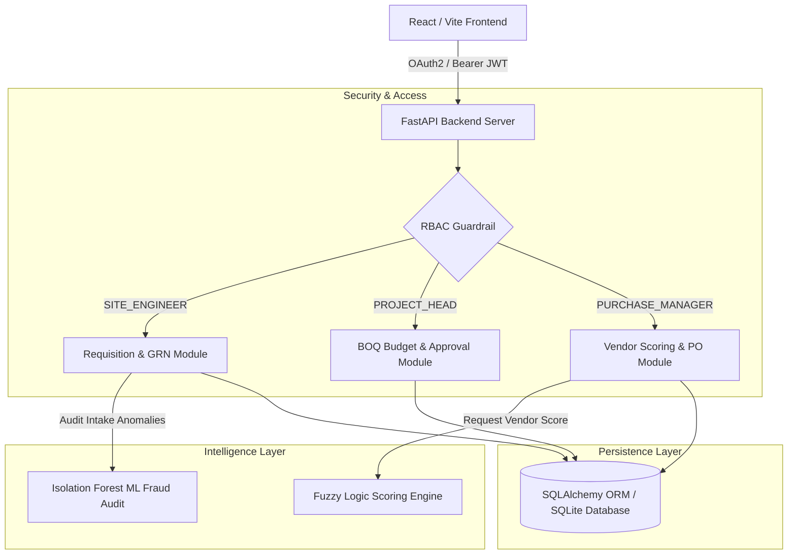
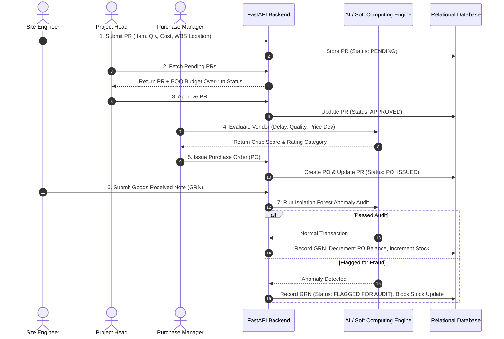
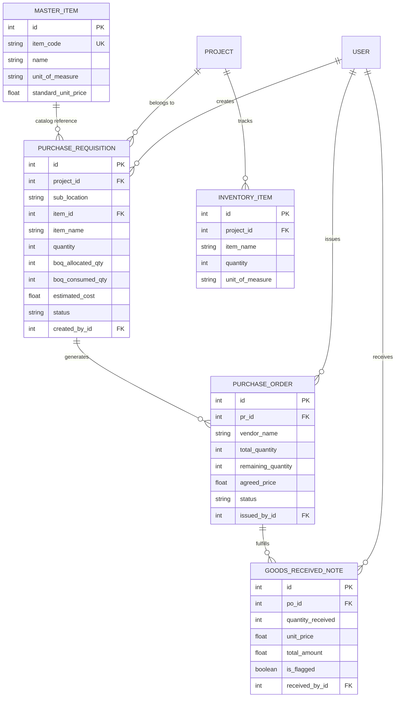

# ConstructERP: AI-Driven Enterprise Construction ERP

An enterprise-grade, full-stack Construction Enterprise Resource Planning (ERP) platform featuring Role-Based Access Control (RBAC), Work Breakdown Structure (WBS) sub-location tracking, real-time Bill of Quantities (BOQ) budget over-run guardrails, Soft Computing vendor scoring (Fuzzy Logic), and Machine Learning fraud auditing (Isolation Forest).

---

## 📋 Table of Contents

1. [Key Features](https://www.google.com/search?q=%23-key-features)
2. [System Architecture & Data Flow](https://www.google.com/search?q=%23-system-architecture--data-flow)
3. [Database Entity-Relationship Schema](https://www.google.com/search?q=%23-database-entity-relationship-schema)
4. [Tech Stack](https://www.google.com/search?q=%23-tech-stack)
5. [Prerequisites & Environment Setup](https://www.google.com/search?q=%23-prerequisites--environment-setup)
6. [Step-by-Step Execution Guide](https://www.google.com/search?q=%23-step-by-step-execution-guide)
7. [User Roles & Quick-Select Credentials](https://www.google.com/search?q=%23-user-roles--quick-select-credentials)
8. [End-to-End Procurement Verification Workflow](https://www.google.com/search?q=%23-end-to-end-procurement-verification-workflow)
9. [Project Directory Structure](https://www.google.com/search?q=%23-project-directory-structure)
10. [License](https://www.google.com/search?q=%23-license)

---

## 🌟 Key Features

* 🔐 **OAuth2 / JWT Authentication & RBAC Isolation:** Strict role segregation and view controls for `SITE_ENGINEER`, `PROJECT_HEAD`, and `PURCHASE_MANAGER`.
* 📍 **WBS Site Location Tagging:** Requisitions mapped down to granular construction sub-locations (e.g., *"Plot 42 / Substation Foundation"*).
* 📊 **Dynamic BOQ Budget Guardrails:** Real-time checking of Purchase Requisitions (PR) against allocated Bill of Quantities (BOQ) limits to raise over-run alerts prior to approval.
* 🧠 **Soft Computing Vendor Scoring Engine:** Mamdani-style Fuzzy Inference System evaluating qualitative metrics (*Delivery Delay*, *Quality Compliance*, *Price Deviation*) to classify vendor risk.
* 🛡️ **ML Fraud Detection Intake:** Isolation Forest anomaly detection algorithm auditing Goods Received Notes (GRN) for price-gouging and volume irregularities before inventory increments.
* 📦 **Master Material Catalog & Partial PO Tracking:** Standardized material item catalog (`MAT-CEM-01`, `MAT-STL-12`) with live remaining pending balance management across multiple delivery receipts.

---

## 📐 System Architecture & Data Flow

The platform separates frontend user interfaces, backend API services, intelligent decision engines, and data storage:



### End-to-End Operational Lifecycle



---

## 🗄️ Database Entity-Relationship Schema



---

## 💻 Tech Stack

| Layer | Component | Description |
| --- | --- | --- |
| **Frontend Framework** | React 18 | Declarative component UI library |
| **Build Tool** | Vite | Next-generation frontend tooling |
| **Styling & UI** | Tailwind CSS & Lucide Icons | Utility-first styling & crisp icons |
| **Backend Framework** | FastAPI | Async, high-performance Python web API |
| **Security & Auth** | OAuth2 + JWT | Bearer tokens with BCrypt password hashing |
| **ORM & Database** | SQLAlchemy & SQLite / Postgres | Declarative database mappings and schema |
| **Soft Computing** | Custom Mamdani Engine | Fuzzy membership functions, rule base, defuzzification |
| **Machine Learning** | Scikit-Learn | Isolation Forest unsupervised anomaly detector |

---

## ⚙️ Prerequisites & Environment Setup

Ensure you have the following software installed locally:

* **Python**: `3.11` or higher
* **Node.js**: `18.0.0` or higher
* **npm**: `9.0.0` or higher

---

## 🚀 Step-by-Step Execution Guide

### Step 1: Setup Virtual Environment & Backend

```powershell
# Navigate to root directory
cd E:\construction-erp

# Create Python Virtual Environment
python -m venv venv

# Activate Virtual Environment (PowerShell)
.\venv\Scripts\Activate.ps1

# Install required Python packages
pip install fastapi uvicorn sqlalchemy scikit-learn numpy python-jose[cryptography] passlib[bcrypt]

# Run the FastAPI server
uvicorn app.main:app --reload

```

* **Backend API Base**: `[http://127.0.0.1:8000](http://127.0.0.1:8000)`
* **Interactive OpenAPI Docs**: `[http://127.0.0.1:8000/docs](http://127.0.0.1:8000/docs)`

### Step 2: Setup & Launch Frontend

Open a **new second terminal window**:

```powershell
# Navigate to frontend directory
cd E:\construction-erp\frontend

# Install Node modules
npm install

# Start Vite development server
npm run dev

```

* **Frontend Web Application**: `http://localhost:5173`

---

## 🔑 User Roles & Quick-Select Credentials

| Role | Email | Password | Allowed Navigation & Actions |
| --- | --- | --- | --- |
| **Site Engineer** | `bob@example.com` | `password123` | • Create WBS-tagged Requisitions<br>

<br>• Submit GRNs for ML Audit<br>

<br>• View Site Inventory |
| **Project Head** | `head@example.com` | `password123` | • Review Requisitions<br>

<br>• Monitor BOQ Budget Over-runs<br>

<br>• Approve or Reject PRs |
| **Purchase Manager** | `pm@example.com` | `password123` | • Soft Computing Vendor Scoring<br>

<br>• Issue Purchase Orders<br>

<br>• Track Partial Delivery Balances |

---

## 🧪 End-to-End Procurement Verification Workflow

1. **Requisition Creation (Site Engineer):**
* Sign in as **Site Engineer** (`bob@example.com`).
* Go to **Requisitions (PR)** $\rightarrow$ Select `[MAT-STL-12] Steel Rebar 12mm`.
* WBS Location: `Plot 42 / Substation Foundation`, Qty: `450`, Cost: `240000` $\rightarrow$ Submit PR.


2. **BOQ Over-run Audit & Approval (Project Head):**
* Sign in as **Project Head** (`head@example.com`).
* Go to **Requisitions (PR)** $\rightarrow$ Review PR #2 showing `BOQ Over-run Risk Alert` (exceeds limit by 50 units).
* Click **Approve**.


3. **Vendor Scoring & PO Generation (Purchase Manager):**
* Sign in as **Purchase Manager** (`pm@example.com`).
* Go to **Vendor Scoring** to test Fuzzy Logic sliders.
* Go to **Purchase Orders** $\rightarrow$ Click **Issue PO** for PR #1. Notice balance updates to `200 Units Pending`.


4. **Intake Audit & Anomaly Detection (Site Engineer):**
* Sign in as **Site Engineer** (`bob@example.com`).
* Go to **GRN & Fraud Audit**.
* **Normal Intake:** Target PO `1`, Qty `200`, Price `425` $\rightarrow$ Status: `PASSED & INVENTORIED` (Stock increases).
* **Fraud Intake:** Target PO `1`, Qty `1500`, Price `950` $\rightarrow$ Status: `FLAGGED FOR FRAUD AUDIT` (Stock blocked).


---

## 📁 Project Directory Structure

```text
construction-erp/
├── app/
│   ├── db/
│   │   ├── base.py                 # SQLAlchemy Base class export
│   │   └── session.py              # Database session & engine binder
│   ├── models/
│   │   └── procurement.py          # MasterItem, PR, PO, GRN, Inventory ORM Schemas
│   ├── routers/
│   │   ├── auth.py                 # OAuth2 authentication & JWT token generation
│   │   ├── pr.py                   # Purchase Requisition API endpoints
│   │   ├── po.py                   # Purchase Order creation & balance tracking
│   │   └── grn.py                  # Goods Received Note & ML intake router
│   ├── analytics/
│   │   ├── fuzzy_vendor.py         # Soft Computing Fuzzy Logic evaluation model
│   │   └── fraud_detector.py       # Isolation Forest anomaly detection algorithm
│   └── main.py                     # FastAPI application entrypoint & middleware
├── frontend/
│   ├── src/
│   │   ├── App.jsx                 # Full-stack React app (RBAC UI, forms, state)
│   │   ├── main.jsx                # DOM mounting entrypoint
│   │   └── index.css               # Tailwind CSS imports
│   ├── package.json                # Frontend dependencies & scripts
│   └── vite.config.js              # Vite server & build configurations
├── .gitignore                      # Environment, build, and node_modules exclusions
└── README.md                       # System documentation

```

---

## 📝 License

Distributed under the MIT License. See `LICENSE` for details.